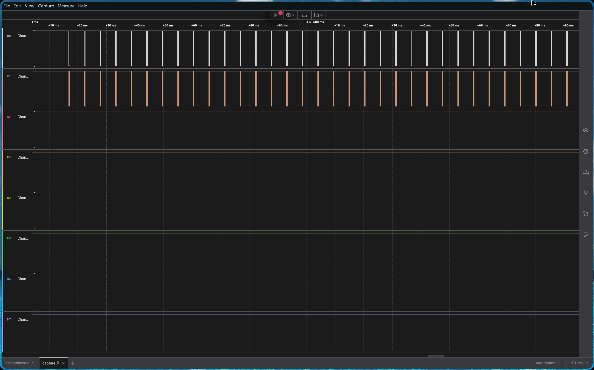
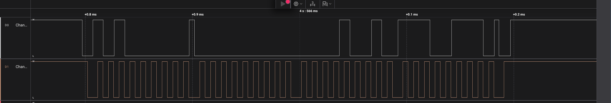

# 22: Chronos' Circuit
The door finally opens and you find yourself looking at another one of Daedalus' projects. It looks like a design script that generates a key using the current time as the seed, encrypts the secret and stores it in an EEPROM. But is that really all it does?

Flag format: `labyrinth{secret}`

## Solution:
Checking the handout from the challenge, we see `capture.sal` and `challenge.ino`. From the file extensions it's obvious that the first is a logic analyzer capture file - which we will open with Saleae Logic Analyzer - and the second is an Arduino sketch file.

Going through the [`.ino`](files/cc/challenge.ino), we find the overall flow of the program to be as such:

  - An I2C connection is initialized with `Wire.begin()`
  - The following function is called:
    ```c
    void generateAesKey() {
      srand(time(0));
      for (int i = 0; i < 16; i++) {
        aesKey[i] = (byte)(rand() % 256);
      }
    }
    ```
    Here, we see that a key is being generated for AES encryption (of some string "secret" given in the `setup()` function) using `rand()`, and the seed being the current time, as dictated by the *avr-libc* library (the one in use on Arduinos).
  
    Going through [`time.h`](files/cc/time.h) from *avr-libc*:
    ```c
      Section 7.23.2.4 time()
      The standard specifies that time() should return (time_t) -1, if the time is not available.
      Since the application must initialize the time system, this functionality is not implemented.
    ```
    where, `time_t` is the time elasped since the Y2K epoch. See also:
    ```c
      There is no 'platform standard' method to obtain the current time, time zone, or
      daylight savings 'rules' in the AVR environment. Therefore the application must initialize
      the time system with this information. The functions set_zone(), set_dst(), and
      set_system_time() are provided for initialization. Once initialized, system time is maintained by
      calling the function system_tick() at one second intervals.
    ```
    In the given `.ino`, we do not see any mention of these initialization functions, hence it is safe to assume that `time_t` is left unset at 0, and therefore the output of `srand(time(0))` will remain constant for all time, therefore the AES key can be found by reversing the implementation of `rand` in *avr-libc*, specified here: [`random.c`](https://github.com/avrdudes/avr-libc/blob/main/libc/stdlib/random.c); analysis of which is unimportant.
  
    Finally, we simply run `rand()` with our pre-determined seed, perform `mod 256` to truncate to a single byte and repeat 16 times to get the final AES key - while taking the seed to be 0 as previously inferred - like so:
    ```python
    def do_rand(x):
      if x == 0:
          x = 123459876
      hi = x // 127773
      lo = x % 127773
      x = 16807 * lo - 2836 * hi
      if x < 0:
          x += 0x7fffffff
      return x, x % 0x80000000
    
    state = 0
    key = bytearray()
    for _ in range(16):
      state, r = do_rand(state)
      key.append(r % 256)
    
    print("key:", key.hex())
    ```
  - Next, a string "secret" and some address is fed to the `encryptAndStore` function:
    ```c
    void encryptAndStore(const String &plainText, unsigned int eepromAddr) {
      int rawLen = plainText.length() + 1; 
      int paddedLen = ((rawLen / 16) + 1) * 16; 
    
      byte plainBuf[paddedLen];
      memset(plainBuf, 0, paddedLen);
      plainText.getBytes(plainBuf, rawLen);
    
      byte cipherBuf[paddedLen];
      byte iv[16];
      memcpy(iv, aesIvSeed, 16); 
      aesLib.encrypt(plainBuf, paddedLen, cipherBuf, aesKey, 128, iv);
    
      byte lenBytes[2] = { (byte)(paddedLen >> 8), (byte)(paddedLen & 0xFF) };
      eepromWriteBlock(eepromAddr, lenBytes, 2);
      eepromWriteBlock(eepromAddr + 2, cipherBuf, paddedLen);
    
      Serial.print("Stored encrypted string, ciphertext length: ");
      Serial.println(paddedLen);
    }
    ```
    From the included [*AESLib.h*](https://github.com/suculent/thinx-aes-lib/blob/master/src/AESLib.h), we get:
    ```c
    uint16_t encrypt(const byte input[], uint16_t input_length, byte *output, const byte key[],int bits, byte my_iv[])
    ```
    Crossreferencing with our given `aesLib.encrypt`, we find that we are performing **AES-128-CBC** encryption here - since the library only includes a CBC mode, no ECB - with the IV being zero (from `byte aesIvSeed[16] = {0};`).

    - The next block after `aesLib.encrypt` uses `eepromWriteBlock`, which is:
    ```c
    void eepromWriteBlock(unsigned int addr, const byte* data, int len) {
        for (int i = 0; i < len; i++) {
            eepromWriteByte(addr + i, data[i]);
    }
    void eepromWriteByte(unsigned int addr, byte data) {
        Wire.beginTransmission(EEPROM_I2C_ADDR);
        Wire.write((int)(addr >> 8));   
        Wire.write((int)(addr & 0xFF));
        Wire.write(data);
        Wire.endTransmission();
        delay(EEPROM_PAGE_DELAY_MS); 
    }    
    ```
    Now, we see that for one I2C transaction, in total 3 bytes are sent over:
      - The higher and lower nibble of the EEPROM address respectively
      - The actual data byte
    
    And, for the first two I2C transactions from `encryptAndStore`, we are only sending over the length of the plaintext/ciphertext - the `paddedLen` calculation occurs because we need to ensure data is sent over in 1 byte chunks.

Finally, after analysis of the `.ino` file, we can move on to extracting the I2C data from the `.sal` file.

Opening in Saleae Logic Analyzer 2, we see: 

Zooming in on one transmission: 

It is quite obvious that *Channel 1* is the SCL line and *Channel 2* is SDA, and using Logic Analyzer's inbuilt Analyzer we export it to a [.csv](files/cc/exportlogic.csv), where, from previous analysis, we know the third data byte of every transmission (after removing the first two transmissions) will give us the required ciphertext, which is: `4b0d83daa4c29be7882623c3beb0ae5feb3ddfdc71bc4bf6ced1c416547a9419`.

Simply performing **AES-128-CBC** decryption on this should suffice to give us the flag; solve script:
```python
from Crypto.Cipher import AES
ciphertext = bytes.fromhex("4b0d83daa4c29be7882623c3beb0ae5feb3ddfdc71bc4bf6ced1c416547a9419")
def do_rand(x):
  if x == 0:
      x = 123459876
  hi = x // 127773
  lo = x % 127773
  x = 16807 * lo - 2836 * hi
  if x < 0:
      x += 0x7fffffff
  return x, x % 0x80000000

state = 0
key = bytearray()
for _ in range(16):
  state, r = do_rand(state)
  key.append(r % 256)
flag = AES.new(key, AES.MODE_CBC, bytes(16)).decrypt(ciphertext)
print (flag)
```
## Flag:
`labyrinth{chr0n0s_st4rt3d_t1m3_fr0m_0!}`

## References:
- [https://github.com/avrdudes/avr-libc](https://github.com/avrdudes/avr-libc)
- [https://github.com/suculent/thinx-aes-lib](https://github.com/suculent/thinx-aes-lib)
- [https://www.pycryptodome.org/src/cipher/aes](https://www.pycryptodome.org/src/cipher/aes)
- [Understanding I2C by Rohde & Schwarz (on YouTube)](https://www.youtube.com/watch?v=CAvawEcxoPU)
