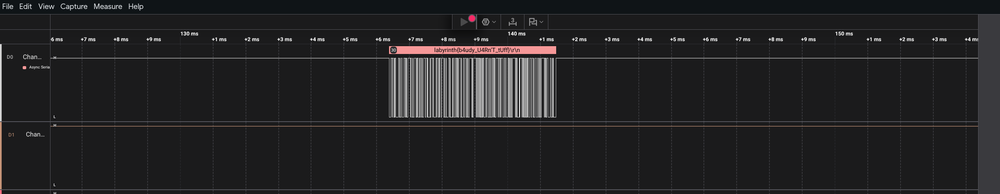
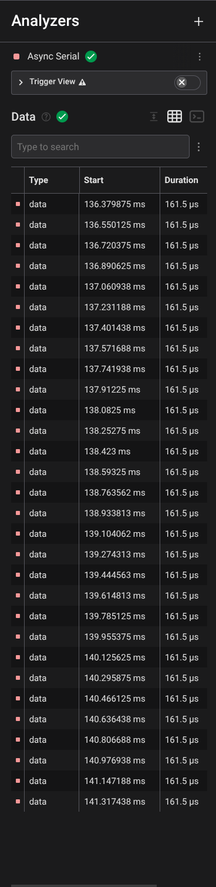

# 10: Sinon's Signal
After exploring the labyrinth, you manage to find a door blocking the way to the next level. But you dont seem to have a key. Suddenly, you recieve an asynchronous message. If you manage to decode it, it might provide you with the key you need to descend into the next layer of the labyrinth. 
## Solution:
Going through the handout, we find a `.sal` file, hence the obvious first step is to open it in Saleae Logic Analyzer.

Lo and behold, we get the flag! But how?

Opening the Analyzers tab, we see that Logic has identified the transmission to be UART (Universal Asynchronous Receiver Transmitter) on its own and hence decoded the signal, and converted to ASCII.

## Flag:
`labyrinth{b4udy_U4Rn'T_tUff}`
## References:
- [https://www.saleae.com/logic](https://www.saleae.com/logic)
- [https://www.analog.com/en/resources/analog-dialogue/articles/uart-a-hardware-communication-protocol.html](https://www.analog.com/en/resources/analog-dialogue/articles/uart-a-hardware-communication-protocol.html)
