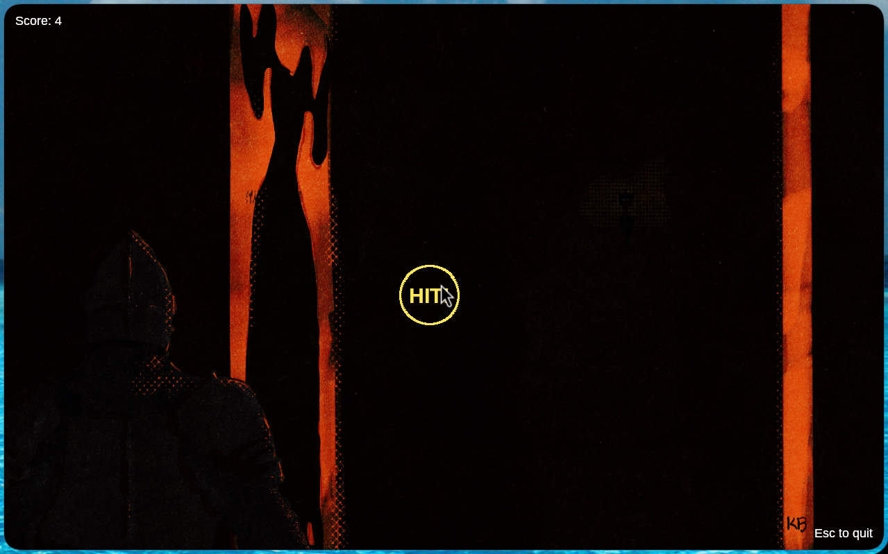

# 9: quick-fate
You come to another one of labyrinth's rooms. A room that seems endless to you and you try to find a way through it but on the way you have to dodge obstacles that will define your fate
Are you quick enough to dodge them??
Flag Format: LABYRINTH{} 

## Solution:
Checking the handout given, we find a `.exe` file and a `.bmp`.
Running the `.exe`, we see it is a *clone of a popular rhythm game*, with the objective being to click the circles as the approach ring reaches the boundary of the circle.



This doesn't give us much of a lead, so we move ahead to [decompiling the binary](files/qf/qf.c) (using *BinaryNinja* on [dogbolt.org](dogbolt.org) here).

Searching through the decomp for phrases we saw in the program, we find the following function of interest:
```c
HGDIOBJ sub_401dc0(HDC arg1, int32_t arg2)
{
    int32_t __saved_ebp;
    int32_t eax_1 = __security_cookie ^ &__saved_ebp;
    sub_4019a0(arg1);
    COLORREF var_190;

    var_190 = !arg2 ? 0x8081e : 0xf1e0a;

    sub_401be0(arg1, var_190, 0x8c);
    int32_t eax_4;
    int32_t edx_1;
    edx_1 = HIGHD(data_41e000);
    eax_4 = LOWD(data_41e000);
    int32_t eax_6 = (eax_4 - edx_1) >> 1;
    int32_t eax_8;
    int32_t edx_2;
    edx_2 = HIGHD(data_41e004);
    eax_8 = LOWD(data_41e004);
    int32_t eax_10 = (eax_8 - edx_2) >> 1;
    void var_e4;

    if (!arg2)
        _snprintf(&var_e4, 0xc0, "YOU FAILED THE TRIAL AND DIED");
    else
    {
        void var_24;
        sub_4011b0(&var_24, 0x19);
        void* var_19c_1 = &var_24;
        _snprintf(&var_e4, 0xc0, "VICTORY! YOUR FLAG IS %s");
    }

    COLORREF var_194;

    var_194 = !arg2 ? 0x4646ff : 0xa0ff78;

    sub_401b40(arg1, &var_e4, eax_6, eax_10 - 0x3c, data_41ead4, var_194);
    int32_t var_19c_3 = data_41ea78;
    void var_184;
    _snprintf(&var_184, 0xa0, "Score: %d");
    sub_401b40(arg1, &var_184, eax_6, eax_10, data_41ead0, 0xffffff);
    HGDIOBJ result =
        sub_401b40(arg1, "Press any key to restart", eax_6, eax_10 + 0x32, data_41ead0, 0xc8c8c8);
    sub_402910(eax_1 ^ &__saved_ebp);
    return result;
}
```

Focusing in on the following:
```c
else{
    void var_24;
    sub_4011b0(&var_24, 0x19);
    void* var_19c_1 = &var_24;
    _snprintf(&var_e4, 0xc0, "VICTORY! YOUR FLAG IS %s");
}
```

Here, we see that based on some condition, the final flag is printed `&var_e4`, however the `%s` in the output isn't being explicitly filled in the decompilation.

However, we do see just before the `snprintf` call a pointer being setup to `&var_24`, hence we can only assume that `&var_24` is where the flag is stored since it is also being setup by [`sub_4011b0`](files/qf/sub_4011b0.c). 

Looking through which, we find that it depends on `sub_401130`:
```c
int32_t sub_401130(){
    if (!data_41eab4){
        for (void* i = nullptr; i < 0x18; i += 1) // 0x18 = 24 in decimal
            *(i + 0x41ea98) = *(i + 0x416210) ^ 0x5a; // XOR'ing one array
            
        data_41eab0 = 0;
        data_41eab4 = 1;
    }
    return 0x41ea98;
}
```
Now that our 24 bytes are built by `sub_401130`, they carry on through `sub_4011b0`, which, for the victory message is fed `&var_24, 0x19` as arguments:
```c
int32_t sub_4011b0(void* arg1, int32_t arg2){
    int32_t result = sub_401130();  // gets a pointer to the XOR'd array
    int32_t result_1 = 0;   // sets up a loop counter

    while (result_1 + 1 < arg2){    // while the counter is < 0x19 (25 in decimal)
        result = *(0x41ea98 + result_1);
        if (!result)
            break;  // breaks if null character (\0) found

        char var_10_1;
        if (*(0x41ea98 + result_1) != 0x20) // 0x20 is ASCII for " " (a space character)
            var_10_1 = *(0x41ea98 + result_1);  // assigns the element currently being iterated (if it is not a space) to var_10_1
        else
            var_10_1 = 0x5f;    // 0x5f is ASCII for "_"
        *(arg1 + result_1) = var_10_1;
        result = result_1 + 1;
        result_1 = result;  // incrementing the loop counter
    }
    *(arg1 + result_1) = 0; // sets the last character to null
    return result;
}
```

Now that we have analyzed how the flag is built, we simply:
  - Get the 24 bytes that are to be XOR'd from `0x416210` onwards
  - Perform XOR with `0x5a`
  - Replace all spaces with underscores

Solve script:
```python
from pwn import *
import pefile

pe = pefile.PE("main.exe")
#print("ImageBase: " + hex(pe.OPTIONAL_HEADER.ImageBase))
rva = 0x416210 - pe.OPTIONAL_HEADER.ImageBase
data = pe.get_data(rva, 24)

flag_bytes = []
for byte in data:
    i = byte ^ 0x5a
    if i == 0x20:
        i = 0x5f
    flag_bytes.append(i)

flag = bytes(flag_bytes)
print(flag.decode())
```
## Flag:
`LABYRINTH{0H_Y0U_ALM0ST_D13D_TH3R3}`
## References:
- [https://bufferoverflows.net/exploring-pe-files-with-python/](https://bufferoverflows.net/exploring-pe-files-with-python/)
- [https://pefile.readthedocs.io/en/latest/modules/pefile.html#pefile.SectionStructure.get_data](https://pefile.readthedocs.io/en/latest/modules/pefile.html#pefile.SectionStructure.get_data)
